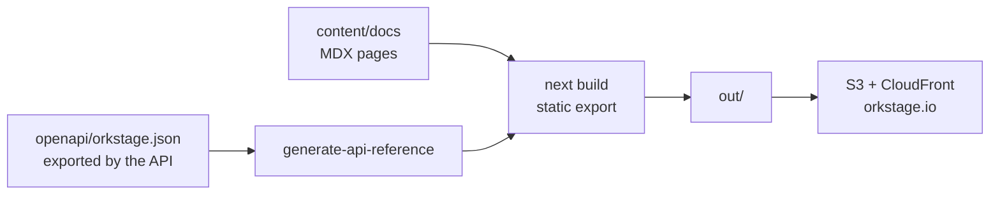

<h1 align="center">
  <picture>
    <source media="(prefers-color-scheme: dark)" srcset=".github/assets/banner-dark.svg">
    <source media="(prefers-color-scheme: light)" srcset=".github/assets/banner-light.svg">
    
  </picture>
</h1>

<p align="center">
  <b>The source of <a href="https://orkstage.io">orkstage.io</a>: the landing page and the OrkStage documentation, built as a static site.</b>
</p>

<p align="center">
  
  <a href="https://github.com/orkstage/orkstage-site/actions/workflows/ci.yml"></a>
  <a href="https://orkstage.io/docs"></a>
</p>

## What it is

Next.js 16 with a static export, [Fumadocs](https://fumadocs.dev) for the documentation, and
Tailwind CSS 4. The build produces plain files in `out/` (pages, search index, sitemap, Open Graph
image) that S3 and CloudFront serve without any server code. The API reference is generated from
the OpenAPI document the OrkStage API exports.



## Quickstart

Requirements: Node 24+ and pnpm 12. This directory is its own pnpm workspace.

```bash
pnpm install
pnpm dev            # http://localhost:3100
pnpm build          # regenerates the API reference, then exports to out/
pnpm serve          # serves out/ the way S3 and CloudFront do, http://localhost:4321
pnpm typecheck      # types, plus check:i18n and check:prose
pnpm check:i18n     # English and Portuguese dictionaries: same keys, writing rules, lengths
pnpm check:prose    # writing rules for every handwritten docs page
pnpm check:site     # after a build: links, anchors, sitemap, hreflang, canonical, JSON-LD, headings
```

## Layout

| Path | What it holds |
|---|---|
| `app/(en)/` | English root layout (`lang="en"`): the landing page at `/`, the docs at `/docs`, the English Open Graph image. |
| `app/(pt)/pt-br/` | Brazilian Portuguese root layout (`lang="pt-BR"`): the landing page at `/pt-br/` and its Open Graph image. Docs stay in English. |
| `app/` | Search index, sitemap (with hreflang alternates), robots and the bilingual 404 page. |
| `lib/i18n/` | Locale config and the typed message dictionaries (`messages/en.ts`, `messages/pt-br.ts`). |
| `lib/seo.ts` | Titles, descriptions, canonical URLs, hreflang, Open Graph and Twitter metadata, JSON-LD. |
| `content/docs/<section>/` | MDX pages. Each section's `meta.json` has `"root": true`, which makes it a sidebar tab. |
| `content/docs/developer/api-reference/` | Generated from `openapi/orkstage.json` (except `index.mdx`). |
| `openapi/orkstage.json` | The OpenAPI document exported by the API (`/api/docs-json`). |
| `public/brand/` | Official brand assets (logo, mark, favicons). Never recolor or stretch them. |
| `infra/` | S3, CloudFront and ACM hosting in OpenTofu, and the deploy steps. |
| `scripts/` | API reference generation, OpenAPI refresh, the local static server, content checks. |

## Refreshing the API reference

```bash
pnpm openapi:refresh                                     # from http://localhost:4000/api/docs-json
ORKSTAGE_API_URL=https://api.example.com pnpm openapi:refresh
```

## Writing docs

- Every page needs `title` and `description` front matter, for search engines and the search
  index.
- Components available in MDX: `Callout`, `Cards` and `Card`, `Steps` and `Step`, `Tabs` and `Tab`,
  `Accordions` and `Accordion`, `Files`, `Folder` and `File`, `TypeTable`, and `Badge` (`Preview`,
  `planned`). Code blocks accept `title="..."` and `tab="..."` (code groups).
- Be exact about status: AWS is real, Azure and OCI are simulated, the `ork` CLI is in Preview.
- "Edit this page" links point to `github.com/orkstage/orkstage-site/blob/main/content/docs/`.
- Run `pnpm check:prose` before opening a pull request.

## Deploying (Hostinger)

The site is a static export (`output: 'export'`): `pnpm run build` writes plain HTML, CSS and JS to
`out/`, and nothing runs on the server. [`public/.htaccess`](public/.htaccess) ships with the export
and configures LiteSpeed: HTTPS and apex redirects, directory pages, the 404 page, security headers,
a year of caching for hashed assets and compression. Two ways to publish it on Hostinger:

### Option A: Hostinger builds `main` (Node.js web app)

Use these build settings; the defaults Hostinger detects for Next.js (server app, output `.next`)
do not fit a static export:

| Setting | Value |
|---|---|
| Branch | `main` |
| Node.js version | 24 |
| Package manager | pnpm |
| Build command | `pnpm run build` |
| Output directory | `out` |
| Framework or application type | static site (Other) |

`packageManager` pins pnpm 11 on purpose: Hostinger installs through corepack (0.34 on Node 24.6),
which cannot start pnpm 12. Keep pnpm 11 here until Hostinger ships a newer corepack.

### Option B: Hostinger serves the `hostinger` branch (no build on Hostinger)

CI builds the static export on every push to `main` and, when the build and every check pass,
commits `out/` to the `hostinger` branch (job `publish-hostinger`). Hostinger pulls the branch into
`public_html`.

One time setup in hPanel (Websites > Manage > Advanced > GIT):

1. Empty `public_html` (File Manager), because the first deployment needs an empty directory.
2. Repository `git@github.com:orkstage/orkstage-site.git`, branch `hostinger`, directory left
   empty (that is `public_html`). For a private repository, hPanel shows an SSH key: add it to
   this repository under Settings > Deploy keys, read only.
3. Create, then press Deploy once.
4. Turn on auto deployment and copy the webhook URL hPanel shows. Add it to this repository under
   Settings > Webhooks (content type `application/json`, just the push event). From then on every
   new commit on `hostinger` deploys by itself.
5. Point the domain at the site (Hostinger nameservers, or an `A` record to the IP hPanel shows)
   and enable the free SSL certificate for `orkstage.io` and `www.orkstage.io`.

To deploy by hand, run the CI workflow on `main` from the Actions tab. To roll back, revert the
change on `main`; the next build deploys the previous content.

The OpenTofu in [`infra/`](infra/) describes an alternative on AWS (S3 and CloudFront); it is not
applied.

## Related repositories

| Repository | Role |
|---|---|
| [`orkstage`](https://github.com/orkstage/orkstage) | Control plane; its CI exports the OpenAPI document used here |
| [`orkstage-console`](https://github.com/orkstage/orkstage-console) | Web console |
| [`orkstage-cli`](https://github.com/orkstage/orkstage-cli) | `ork` CLI and scan engine |
| [`orkstage-modules`](https://github.com/orkstage/orkstage-modules) | OpenTofu modules |
| [`orkstage-dev`](https://github.com/orkstage/orkstage-dev) | Runs the whole stack locally |

## Contributing

Fixes to the docs are the easiest way to contribute: use "Edit this page" on any page, or open a
pull request here. The organization [contributing guide](https://github.com/orkstage/.github/blob/main/CONTRIBUTING.md)
covers the workflow and the code of conduct.

## Security

Report vulnerabilities privately through
[GitHub Security Advisories](https://github.com/orkstage/orkstage-site/security/advisories/new)
or to security@orkstage.io.

## License

Code under the MIT License; documentation content under
[CC BY 4.0](https://creativecommons.org/licenses/by/4.0/). The OrkStage name and logo are
trademarks and are not covered by either license.
