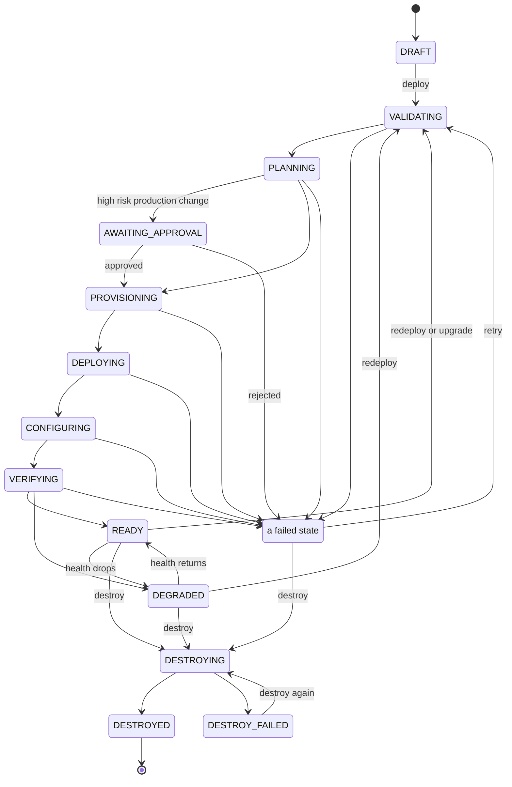
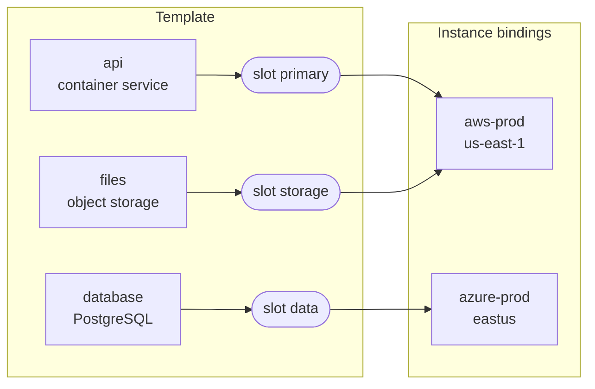

## Tenants and organizations

An **organization** runs one OrkStage installation. It serves **tenants**, the customers or teams
that own instances. Every record that belongs to a tenant carries its tenant id. A user sees a
tenant only through a membership with one of the [roles](/docs/user-guide/roles/). A tenant can have
**limits**.

## Instance (stage)

An **instance**, also called a **stage**, is one isolated, logical environment for one tenant. It
holds the services, database, cache, queue, storage, ingress and DNS, for example *Acme Production*
or *Acme Staging*. Each instance has an environment kind (`production`, `staging`, `development` or
`sandbox`), a template version, variable values and one placement binding per slot.

The instance status follows a state machine, and every transition is validated:

The failed states are `VALIDATION_FAILED`, `PLAN_FAILED`, `PROVISION_FAILED`, `DEPLOY_FAILED` (also
from `CONFIGURING`) and `VERIFICATION_FAILED`. A rejected approval ends in `PLAN_FAILED`, and a
destroy cancelled before anything was deleted returns the instance to `READY`.

Only one operation runs on an instance at a time. A second deploy or destroy gets
`409 INSTANCE_BUSY`.

## Template

A **template** (`apiVersion: platform/v1`, `kind: EnvironmentTemplate`) describes business intent,
never provider resource blocks. Examples: "a container service with two replicas", "a Postgres
database spread across availability zones", "private connectivity from api to database".

Templates are versioned. A published version never changes, and an instance moves to a new version
only through an explicit upgrade. OrkStage ships six templates, from `free-validation` to
`multicloud-reference`. See the [template reference](/docs/developer/template-reference/).

## Placement slots and cloud targets

A **cloud target** is an account you register with a provider: an AWS account, an Azure
subscription or an OCI tenancy. It stores the allowed regions and configuration that is not secret.
Credentials are stored as references, never as values.

A template declares **placement slots** such as `primary`, `data` and `storage`, and lists the
providers each slot accepts. Every resource names a slot, and an instance binds each slot to a target
and a region. Bind all slots to one AWS account and the template runs on a single cloud. Bind `data`
to Azure and the same template becomes multicloud.

 See
[ADR 0001](/docs/contributing/architecture-decisions/#0001-per-resource-placement-through-template-slots).

### One account per environment

Most organizations keep production, staging and development in separate accounts of the same
provider. Register one target per account, each with its own credentials, and set the environment
it serves: `production`, `staging`, `development` or `sandbox`. An instance can only deploy into
targets of its own environment; the `target-environment` policy stops a production instance from
landing in a development account, and a development instance from touching production. Mark a
target `any` only when it is meant for every environment, such as the simulation targets.

| Target | Provider | Account | Environment |
|---|---|---|---|
| `aws-prod` | AWS | 111111111111 | `production` |
| `aws-staging` | AWS | 222222222222 | `staging` |
| `aws-dev` | AWS | 333333333333 | `development` |

Target names are unique within a tenant (and among shared targets), ignoring case.

### Profiles

A **profile** gives a name to a setup for one environment: the cloud target, and optionally the
region, to use for each provider. For example, "Production Europe" can name `aws-prod` in
`eu-west-1` and `azure-prod` in `westeurope`, and "Production Brazil" the same accounts in
`sa-east-1` and `brazilsouth`. Platform owners and admins create profiles in **Profiles**, shared
with every tenant or for one tenant, and mark one **default** per environment.

When an instance is created, every slot it leaves unbound is bound from the profile it names, or
from the default profile of its environment: the tenant's own default before a shared one, the
exact environment before `any`. Each slot gets the profile's target for the first provider in the
slot's list that the profile has, with the profile's region or else the target's default region.
In the console, choose the profile on the placement step; with the API, send `profileId` and leave
slots out of `bindings`; with the CLI, set `[instance].profile` and leave slots out of
`[placements]`.

Tenant members do not see cloud targets, so a profile is how they place an instance: they choose
it, and OrkStage fills in the accounts. The bindings and the profile are stored with the instance,
so editing or deleting the profile later never moves an existing instance.

## Capabilities

Each provider adapter publishes a **capability catalog**. For each logical resource type, it lists
the concrete service that implements it, with its features, regional gaps and static list prices.
For example, `database.postgresql` maps to `rds-postgres` on AWS, `flexible-server` on Azure and
`oci-postgresql` on OCI. The resolver picks the default, or the `implementation` the template
prefers, and suggests alternatives when nothing fits.

| Logical type | AWS | Azure (Preview) | OCI (Preview) |
|---|---|---|---|
| `network` | VPC | Virtual Network | VCN |
| `compute.container-service` | ECS on Fargate, ECS on EC2 | Container Apps | Container Instances |
| `container-registry` | ECR | Container Registry | Not in the catalog |
| `database.postgresql` | RDS for PostgreSQL | PostgreSQL Flexible Server | Database with PostgreSQL |
| `cache.redis` | ElastiCache (Valkey) | Cache for Redis | Not in the catalog |
| `queue` | SQS | Service Bus | Not in the catalog |
| `object-storage` | S3 | Blob Storage | Object Storage |
| `ingress` | Application Load Balancer | Application Gateway | Not in the catalog |
| `dns` | Route 53 and ACM | Azure DNS | Not in the catalog |

## Tenant limits and features

Platform owners and admins can give each tenant **limits**. Every limit is optional: a tenant
without one may use anything the platform offers. Set them in **Tenants > Limits** or with
`PATCH /api/v1/tenants/{id}` and a `limits` object.

| Limit | Checked |
|---|---|
| `maxInstances` | When an instance is created: instances that are not destroyed (`QUOTA_EXCEEDED`). |
| `maxServicesPerInstance` | Container services in one instance. |
| `maxVcpuPerInstance`, `maxMemoryGiBPerInstance` | Each service's CPU and memory times its replicas, or its autoscaling ceiling. |
| `maxReplicasPerService` | Replicas, or the autoscaling ceiling, of any one service. |
| `maxDatabaseGiBPerInstance` | Database storage of one instance. |
| `maxDomainsPerInstance` | Custom domains of one instance (the platform subdomain does not count). |
| `maxBackupRetentionDays` | Backup retention of any one database. |

What a tenant's templates may use is decided by [feature flags](/docs/providers/#enabling-a-provider),
on by default and turned off for the platform or for one tenant: `MULTI_CLOUD` (resources on
more than one provider), `MULTI_REGION` (more than one region of a provider), `AUTOSCALING` and
`CUSTOM_DOMAINS`.

The compiler checks limits and features every time an instance is previewed or deployed, so an
instance that no longer fits fails before anything changes. Templates do not name plans or
tenants: any template whose resources fit can be used by any tenant
([ADR 0007](/docs/contributing/architecture-decisions/#0007-profiles-tenant-limits-and-template-tags-instead-of-plans)).

## Plan (deployment plan)

When you preview an instance, OrkStage compiles the template into a **resolved infrastructure**:

- variables applied;
- each resource bound to a target, a region and a capability;
- names and tags assigned;
- a dependency graph;
- a connectivity strategy for each link;
- a policy report and an approximate cost.

A diff against the known resources gives the **deployment plan** (create, update, delete,
unchanged) and its risk. This step never touches a cloud. The deployment stores a snapshot of the
plan, so OrkStage applies exactly what you previewed. See
[Reviewing plan & cost](/docs/user-guide/plan-and-cost/).

## Deployment and the DAG

A **deployment** applies a plan in the background. The worker runs fixed phases: validate, targets,
plan, approval (when needed), resources, rollout, configure, verify, observability and finalize.

Resources are provisioned in dependency order, and independent branches run in parallel. The worker
retries transient failures with backoff. A failed resource blocks only the resources that depend on
it. After a worker crash, the deployment resumes where it stopped. See
[Deploying and watching progress](/docs/user-guide/deploy/).

## Knowledge: desired, known, actual

The database holds the **desired** state (template and configuration) and the **known** state (what
OrkStage recorded). The provider holds the **actual** state. Each resource carries a knowledge
state (`DESIRED`, `KNOWN`, `ACTUAL` or `UNKNOWN`) and a drift status.

## Health, incidents and status

OrkStage checks health (`HEALTHY`, `DEGRADED`, `UNHEALTHY`, `UNKNOWN` or `MAINTENANCE`) on each
resource and rolls it up to the instance. An unhealthy critical component makes the instance
unhealthy. Any other problem makes it degraded.

Resources map to **status components** that customers see, such as API, Workers and Database, on a
private **status page**. Alert rules open **incidents**, deduplicated per resource and subject to a
cooldown. An incident resolves on its own when health returns. **Notifications** go to
the console, to email and to signed [webhooks](/docs/developer/webhooks/).

## Audit

Every action that changes state writes an **audit event** with the actor (user or API key), tenant,
resource, action, correlation id and changes. The audit table only accepts inserts. A Postgres
trigger enforces this.
