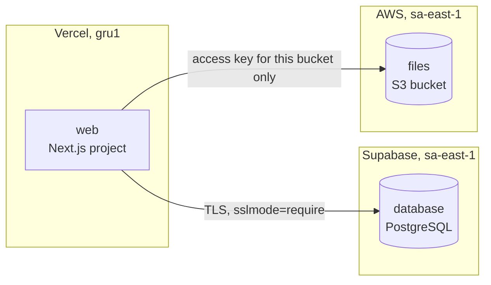

Each placement slot of a template can go to a different provider, so you can put every part of an
app where it costs least. This page follows the built in **Web app on managed platforms** template
(`web-platforms`) with a common low cost layout:

- the website on **Vercel**,
- PostgreSQL on **Supabase**,
- uploads in an **AWS S3** bucket.



<Callout title="Preview" type="warn">
  The Vercel and Supabase adapters are in <Badge>Preview</Badge>: covered by unit tests, not yet
  verified against live accounts.
</Callout>

## The template

```yaml title="07-web-platforms.yaml"
apiVersion: platform/v1
kind: EnvironmentTemplate
metadata:
  name: web-platforms
  version: 1.0.0
  displayName: Web app on managed platforms
  profile: growth
spec:
  plans: [GROWTH, SCALE]
  placements:
    - name: web
      description: Website or web app built from a Git repository.
      providers: [vercel, render, mock]
    - name: data
      description: Relational database.
      providers: [supabase, render, aws, gcp, azure, mock]
    - name: files
      description: Uploads and static files.
      providers: [aws, gcp, azure, supabase, digitalocean, mock]
  variables:
    - name: databaseSize
      type: string
      default: micro
      allowed: [micro, small, medium, large]
      target: database.size
  resources:
    - id: database
      type: database.postgresql
      placement: data
      size: micro
      storageGiB: 8
      publicAccess: true
      backup: { enabled: true, retentionDays: 7 }
    - id: files
      type: object-storage
      placement: files
      tier: standard
      versioning: true
      accessKeys: true
    - id: web
      type: web.frontend
      placement: web
      source:
        repository: acme/website
        branch: main
      framework: nextjs
      environment:
        NEXT_PUBLIC_APP_NAME: Acme
      dependsOn: [database, files]
  connectivity:
    - from: web
      to: database
      protocol: postgres
      mode: secure
  triggers:
    - name: redeploy-site
      description: Rebuild and publish the site, for example after a CMS publish or a merge.
      resource: web
      action: redeploy
      params: { target: production }
      overridable: [ref]
      on: { manual: true, webhook: true }
    - name: nightly-backup
      description: Daily restore point of the database.
      resource: database
      action: backup
      on: { manual: true, schedule: '0 3 * * *' }
```

`accessKeys: true` on `files` matters here: a Vercel app cannot assume an AWS role, so the AWS
module creates an access key limited to this one bucket for it.

## Bind the slots

<Steps>
<Step>

### Register three targets

Register one cloud target per provider: a [Vercel](/docs/providers/vercel/) team, a
[Supabase](/docs/providers/supabase/) organization and an [AWS](/docs/self-hosting/connect-aws/)
account. Each has its own `credentialRef`.

</Step>
<Step>

### Create the instance

Bind each slot to a target and a region, keeping them close to each other:

| Slot | Target | Region | Resource |
|---|---|---|---|
| `web` | Vercel | `gru1` | `web`, a Vercel project |
| `data` | Supabase | `sa-east-1` | `database`, a Supabase project |
| `files` | AWS | `sa-east-1` | `files`, an S3 bucket |

The Vercel region sets where its functions run, so put it next to the database.

</Step>
<Step>

### Review the plan and deploy

The plan shows the capability chosen for each resource (`vercel-project`, `supabase-postgres`,
`s3`), the cost estimate and the connectivity strategy. `web` and `database` are on different
providers, and the template asks for `mode: secure`, so the plan picks `public-tls`: TLS over the
public network. Supabase connection strings carry `sslmode=require`. See
[plan and cost](/docs/user-guide/plan-and-cost/).

The deployment follows the dependency graph: `database` and `files` first, then `web`, which
depends on both.

</Step>
</Steps>

## How credentials pass between providers

The frontend needs the database password and the bucket key, but those belong to other providers.
OrkStage moves them at deploy time without keeping a copy:

1. `database` and `files` publish only a reference in their outputs (`secret_ref`), never a value.
2. When the Vercel adapter deploys `web`, it asks OrkStage for the credentials of each dependency
   that has a `secret_ref`.
3. OrkStage calls `readSecret` on the adapter that **owns** the dependency, with that target's own
   credentials:
   - **Supabase** derives the database password again from the OrkStage encryption key. It is never
     stored anywhere: it was derived the same way when the project was created.
   - **AWS** reads the bucket key from the Secrets Manager secret the module created in your
     account, using the deployment role.
4. The Vercel adapter writes the values to the project as `sensitive` environment variables, which
   Vercel never shows again.

The values pass through the control plane's memory only. They are not written to the OrkStage database,
outputs or logs. The S3 key itself lives in your AWS account: in the OpenTofu state in your state
bucket and in the Secrets Manager secret. Its IAM policy allows `s3:ListBucket`,
`s3:GetBucketLocation`, `s3:GetObject`, `s3:PutObject`, `s3:DeleteObject` and
`s3:AbortMultipartUpload` on that bucket only.

## What the frontend receives

Variable names come from the resource id: `database` becomes `DATABASE`, `files` becomes `FILES`
(upper case, any other character turned into `_`). Connection settings from outputs are added as
`<ID>_HOST`, `<ID>_PORT`, `<ID>_URL`, `<ID>_BUCKET`, `<ID>_ENDPOINT` and `<ID>_REGION`. Each
credential field becomes `<ID>_<FIELD>`, with camel case turned into upper snake case
(`poolerUrl` becomes `POOLER_URL`, `secretAccessKey` becomes `SECRET_ACCESS_KEY`). When a name
comes from both, the credential wins and the variable is stored as sensitive.

| Variable | Value | Vercel type |
|---|---|---|
| `NEXT_PUBLIC_APP_NAME` | `Acme`, from the template `environment` | encrypted |
| `DATABASE_URL` | Direct connection string with the password, `sslmode=require` | sensitive |
| `DATABASE_POOLER_URL` | Supavisor pooler connection string, when Supabase reports a pooler | sensitive |
| `DATABASE_HOST` | `db.<ref>.supabase.co` | sensitive |
| `DATABASE_PORT` | `5432` | sensitive |
| `DATABASE_USERNAME` | `postgres` | sensitive |
| `DATABASE_PASSWORD` | The derived password | sensitive |
| `DATABASE_DATABASE` | `postgres` | sensitive |
| `DATABASE_REGION` | Supabase region, for example `sa-east-1` | encrypted |
| `FILES_BUCKET` | Bucket name | sensitive |
| `FILES_REGION` | AWS region of the bucket | sensitive |
| `FILES_ENDPOINT` | Regional HTTPS endpoint of the bucket | encrypted |
| `FILES_ACCESS_KEY_ID` | Access key id limited to the bucket | sensitive |
| `FILES_SECRET_ACCESS_KEY` | Secret of that access key | sensitive |

The variables are set for the production and preview environments of the project.

<Callout>
  Vercel functions connect over IPv4, and the Supabase direct host is IPv6 only unless the project
  has the paid IPv4 address option. Use `DATABASE_POOLER_URL` from the app.
</Callout>

```ts title="lib/clients.ts"
import { S3Client } from '@aws-sdk/client-s3';
import postgres from 'postgres';

export const sql = postgres(process.env.DATABASE_POOLER_URL!);

export const files = new S3Client({
  region: process.env.FILES_REGION,
  credentials: {
    accessKeyId: process.env.FILES_ACCESS_KEY_ID!,
    secretAccessKey: process.env.FILES_SECRET_ACCESS_KEY!,
  },
});
export const bucket = process.env.FILES_BUCKET!;
```

## Triggers in this template

| Trigger | Resource | Action | Runs |
|---|---|---|---|
| `redeploy-site` | `web` | `redeploy` with `target: production`; callers may set `ref` | From the console, or from CI or a CMS with an API key (`on.webhook`) |
| `nightly-backup` | `database` | `backup`, a Supabase restore point | From the console, and every day at 03:00 UTC |

Restore points depend on the Supabase organization plan; where they are not offered, the run fails
with a clear message. See [triggers](/docs/user-guide/triggers/) for running them from CI.

## Other placements

The same template accepts other providers in each slot. What changes:

| Slot | Choice | What to know |
|---|---|---|
| `web` | Render static site | Environment variables are available at build time only. |
| `data` | Render Postgres | The frontend also gets `DATABASE_INTERNAL_URL`. Render Postgres offers only `restart`, so `nightly-backup` is unavailable. |
| `data` | Google Cloud or Azure | Not reachable from Vercel as is: a Cloud SQL instance without a network accepts only Cloud SQL connectors, and an Azure server with `publicAccess` accepts Azure services only. |
| `files` | Supabase Storage | The bucket must depend on the Supabase database (add `dependsOn: [database]` to `files`). The frontend gets `FILES_URL`, `FILES_SERVICE_ROLE_KEY` and `FILES_ANON_KEY` instead of an S3 key. |
| `files` | Google Cloud, Azure or DigitalOcean | The frontend gets the bucket name, endpoint and region, but no credentials: only the AWS adapter creates keys for `accessKeys` today. |

Provider pages list every capability and limit: [Vercel](/docs/providers/vercel/),
[Render](/docs/providers/render/), [Supabase](/docs/providers/supabase/),
[Google Cloud](/docs/providers/gcp/), [Microsoft Azure](/docs/providers/azure/),
[DigitalOcean](/docs/providers/digitalocean/).
