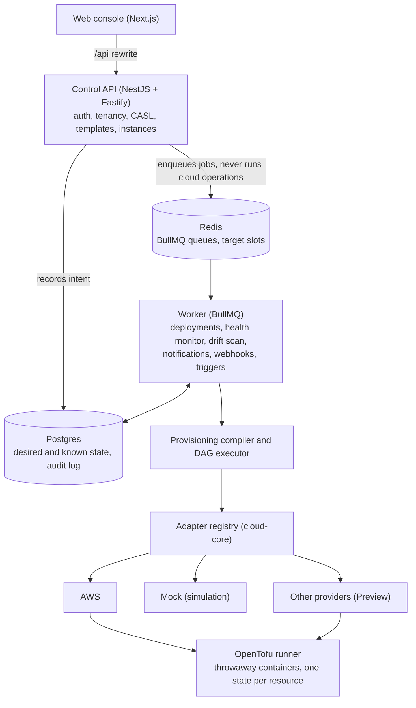
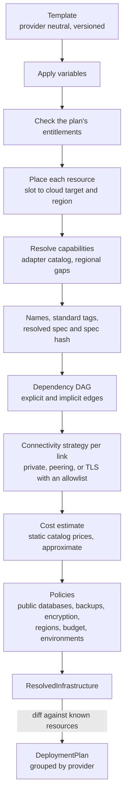

## Components

| Component | Role |
|---|---|
| **Console** | Next.js app. It calls the API through its own origin, so cookies stay first party and the API needs no CORS. |
| **Control API** | Authentication, tenancy, authorization, templates, instances and integrations. It records intent and enqueues jobs. It never calls a cloud while handling a request. |
| **Worker** | Runs deployments, the health monitor, drift scans, email and webhook delivery. It is the only process that changes cloud resources. |
| **Postgres** | Desired and known state, deployments and their steps, and the audit log (append only). |
| **Redis** | BullMQ queues and the concurrency slots of each cloud target. |
| **OpenTofu runner** | Each `tofu` command runs in a throwaway container that the worker starts. |

The domain packages (`domain`, `templates`, `provisioning`) import no cloud SDK and no framework.
Provider code lives only in the `cloud-*` packages.

## From template to cloud

None of these steps touches a cloud. A deployment stores the `ResolvedInfrastructure` snapshot, so
OrkStage applies exactly what you previewed.

## Deployment workflow

OrkStage creates all steps when the deployment is requested, so the console shows the whole plan at
once. A job carries only the deployment id. The worker persists each phase and resource step before
and after it runs.

- If a worker crashes, BullMQ delivers the job again (its stalled job handling) and the deployment
  resumes. Finished phases are skipped, and converged resources (same idempotency key) are not
  applied again.
- A failed resource skips only the resources that depend on it. Only transient failures (rate limits,
  network errors, timeouts) are retried, with exponential backoff. Destructive operations are never
  retried.
- An instance has at most one active deployment, enforced by an atomic compare and set on its status.
  Each cloud target has a configurable slot limit (`maxConcurrentDeployments`, kept in Redis).
- A deployment that needs approval is parked. Approving it puts it back in the queue.

[ADR 0003](/docs/contributing/architecture-decisions/#0003-deployment-workflow-on-bullmq-with-persisted-steps)
explains why the workflow runs on BullMQ rather than Temporal.

## Provider adapters

`CloudProviderAdapter` is the only way the platform touches a cloud. It defines `validateTarget`,
`capabilities`, an idempotent `ensureResource`, `deleteResource`, `getResource` and `checkHealth`, plus
optional logs, metrics, plan and existence probes. One shared contract test suite runs against every
adapter.

| Adapter | Status |
|---|---|
| AWS (`cloud-aws`) | Real. Provisions with OpenTofu, checks health with the AWS SDK, reads CloudWatch logs and assumes a role in each connected account. |
| Mock (`cloud-mock`) | Deterministic simulation of AWS, Azure or OCI, chosen per target, with injectable failures, latency, health overrides and drift. Everything it creates is labeled simulated. |
| Azure, Google Cloud, OCI, DigitalOcean, Vultr, CoreWeave, Magalu Cloud (`cloud-<provider>`) | Preview. OpenTofu adapters covered by tests and `tofu validate`, not yet proven on live accounts. Off by default behind a feature flag per provider. See [providers](/docs/providers/). |
| Vercel, Render, Supabase | Preview. Adapters that call the platform APIs, behind the same flags. |

## Desired, known and actual state

The database holds **desired** state (templates and instance configuration) and **known** state (what
OrkStage recorded). The providers hold **actual** state. Each resource row has a knowledge state and a
drift status. Health checks read actual state again on every tick, and the drift scan plans applied
resources again on real providers.

## Tenancy and security model

All tenants share one database, and every row a tenant owns carries an explicit `tenantId`. Isolation
has four layers, in order: the request principal, query scoping by membership, a CASL check on the
loaded record, and the audit log.

Sessions are opaque and stored on the server. Requests need a CSRF header, the API allows no CORS,
secrets are stored as references only, provider credentials never reach the browser and the audit log
is append only. See [Security hardening](/docs/self-hosting/security/) and
[ADR 0004](/docs/contributing/architecture-decisions/#0004-tenancy-sessions-and-authorization).
