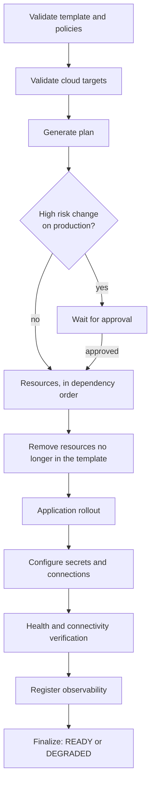
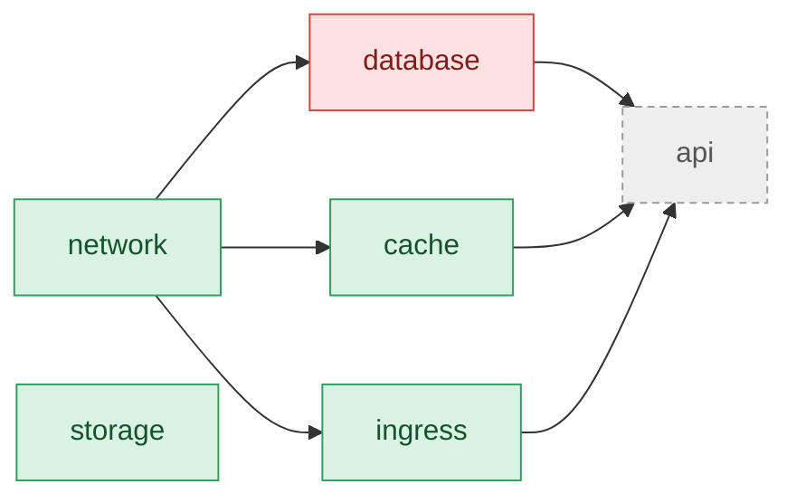
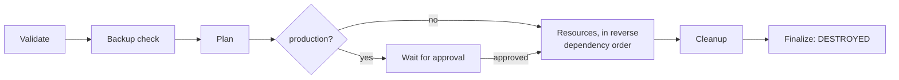

Click **Deploy** on an instance. The API validates the request, records the deployment with all its
steps and answers at once with `202`. The worker then does the work, so you can close the browser.

## Phases



| Phase | What happens |
|---|---|
| Validate template and policies | The stored snapshot is checked again. A failing policy stops the deployment here. |
| Validate cloud targets | Checks credentials, the state bucket and, on real AWS, the IAM permissions the deployed services need. |
| Generate plan | Builds the platform diff, plus a real `tofu plan` for each existing resource that changes. |
| Approval | Runs only for high risk production changes (see below). Otherwise it is skipped, with the reason. |
| Resources | One step per resource, in dependency order. Independent branches run in parallel. |
| Remove resources no longer in the template | Deletes resources the instance still has but the template no longer contains (after an upgrade, or a resource turned off by a variable), dependents first. The plan lists them as deletions, so production approval covers them. A destroy protected instance keeps them, with a warning. |
| Application rollout | Services run their images by digest, so the exact image never changes under them. |
| Configure secrets and connections | Wires connection references. Secret values stay in the secret store. |
| Health and connectivity verification | Checks each resource until it is healthy, within one settle window. |
| Register observability, Finalize | Registers monitoring and moves the instance to `READY` or `DEGRADED`. |

The deployment page shows each step with its status, the Gantt **timeline** and the **event log**.
It refreshes every 1.5 seconds while the deployment runs.


## Approvals

A deployment of a `production` instance stops at `AWAITING_APPROVAL` when the change is high risk.
That happens in two cases:

- The platform plan deletes or replaces a resource, or changes an existing database.
- The **provider plan** deletes or replaces something. This is a real `tofu plan`, run for each
  changed resource during the plan phase. It can find a replacement even when the platform diff
  shows only an update, for example when an attribute forces replacement. Routine ECS task
  definition revisions do not count.

The event log shows the provider plan for every changed resource, and destructive ones appear as
warnings:

```text
WARN  [phase:plan] ingress: 1 to add, 0 to change, 1 to destroy — replace aws_lb_target_group.route[0]
WARN  [phase:plan] The provider plan deletes or replaces existing resources: production approval required.
WARN  [phase:approval] High-risk production change: waiting for approval.
```

OrkStage notifies the owners and admins, and the `deployment.awaiting_approval` webhook fires. A
user with the `approve` permission clicks **Approve**, and the deployment continues.

When the plan contains no high risk change, the approval step is marked skipped with the reason
`Not needed: no high-risk or destructive changes planned.` Instances in other environments
(`staging`, `development`, `sandbox`) never wait for approval.

## Failures, retries and cancel

- Transient failures, such as throttling and timeouts, are retried with exponential backoff.
  Destructive operations are never retried automatically.
- A failed resource skips only the resources that depend on it, and unrelated branches finish.
  Partial failure is a normal outcome, shown per resource. In this example the database fails, so
  the API that depends on it is skipped, while storage and the cache finish:



- **Retry** runs only the failed and skipped resources again. Resources that already converged are
  left alone.
- **Cancel** stops the deployment cooperatively. The worker checks for the request while it runs,
  and resources that have not started yet are marked cancelled.
- If the worker restarts, the deployment resumes. Finished phases are skipped, and converged
  resources (same idempotency key) are not applied again.

## Resources deleted outside OrkStage

Someone may delete a resource directly in the provider console. During verification, OrkStage asks
the provider whether each resource still exists. A missing resource fails verification at once,
with the message `Resource no longer exists at the provider. Redeploy to re-create it.`, instead of
waiting for it to settle. The next deployment creates it again.

## Upgrading the template

**Change template version** shows the plan from what runs now to the chosen version (what is
created, updated and deleted), then starts a deployment of that version. The instance keeps its
current version until that deployment succeeds, so a failed upgrade leaves it on the version that
actually runs; **Retry** continues the upgrade. Choosing an older version rolls back the same way.
Production upgrades that delete or replace resources wait for approval. An instance never changes
version on its own.

Through the API: `POST /instances/{id}/preview?templateVersionId={version}` returns the plan, and
`POST /instances/{id}/upgrade` with `{ "templateVersionId": "..." }` starts the deployment.

## Destroying

**Destroy** removes every cloud resource in reverse dependency order:



To confirm, you type the instance slug. An instance marked *Destroy protected* refuses to be
destroyed. Only customer owners and admins, and platform owners and admins, can destroy an
instance. Destroying a `production` instance also waits for an approval before anything is
deleted; cancelling it at that point leaves the instance `READY`.

A `production` instance whose databases have no backup from the last day is not destroyed: the
request is refused with `BACKUP_NOT_RECENT` and the console lists the databases. Run a backup or
wait for the next one, or tick **Destroy without a recent backup** (API:
`withoutRecentBackup: true`). Where the provider supports it, a final snapshot is still taken. See
[Disaster recovery](/docs/self-hosting/disaster-recovery/).
