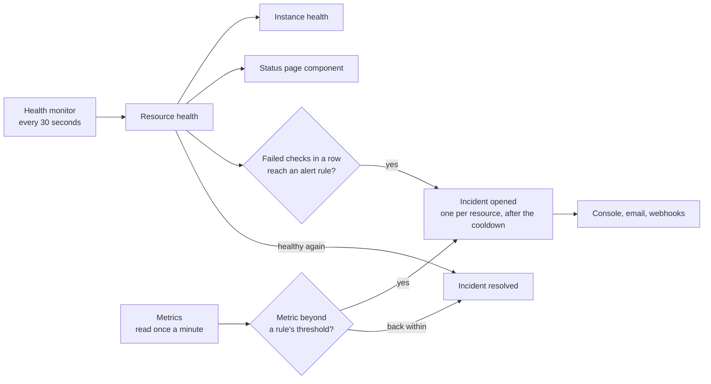

## From resource health to instance health



The worker's health monitor checks every active resource through its provider adapter at a fixed
interval: `HEALTH_CHECK_INTERVAL_SECONDS`, 30 by default. Instance health then follows from the
health of its components:

| Components | Instance |
|---|---|
| A **critical** component is `UNHEALTHY` | `UNHEALTHY` |
| Any component is `UNHEALTHY` or `DEGRADED` | `DEGRADED` |
| Some components are `UNKNOWN` | `DEGRADED` (`UNKNOWN` when all are unknown) |
| All components are in `MAINTENANCE` | `MAINTENANCE` |
| Otherwise | `HEALTHY` |

Services and databases are critical by default. Caches, queues and storage are not. A template can
change this per resource with the `critical` field.

## The status page


Each tenant has a **private status page**, at `/status/<tenantId>` in the console. It groups
resources into components that customers see: API, Workers, Database, Cache, Messaging, Storage,
and DNS & TLS. The headline shows the worst component state.

| Health | Status component |
|---|---|
| `HEALTHY` | `OPERATIONAL` |
| `DEGRADED` | `DEGRADED` |
| `UNHEALTHY` (critical) | `MAJOR_OUTAGE` |
| `UNHEALTHY` (not critical) | `PARTIAL_OUTAGE` |
| `MAINTENANCE` | `MAINTENANCE` |
| anything else | `UNKNOWN` |

Members of the tenant and platform staff can read the page. Public pages and status subscriptions
are on the roadmap.

## Automated incidents

Alert rules decide when OrkStage opens an incident on its own. There are two kinds:

- **Health rules** count failed health checks in a row.
- **Metric rules** compare a statistic of a metric (average, maximum or minimum) over a window of
  minutes with a threshold, for example "average CPU % above 80 over 5 minutes".

OrkStage seeds two health rules:

| Rule | Opens an incident after | Severity | Cooldown |
|---|---|---|---|
| `Critical resource unhealthy` | 3 failed health checks in a row | high | 15 minutes |
| `Non-critical resource unhealthy` | 5 failed health checks in a row | medium | 30 minutes |

Incidents follow three rules:

- They are **deduplicated** per rule and resource. A resource has at most one open incident for a
  rule, so a flapping resource never opens many.
- After an incident resolves, a **cooldown** passes before a new one can open for the same
  resource and rule.
- They are **resolved automatically** when health returns or the metric is back within the
  threshold, with a final update. A rule with **Resolve when it clears** turned off leaves the
  incident open for a person to close.

### Managing alert rules


**Alert rules**, in the console menu (`/settings/alerts`), lists the rules that apply to you and
lets you add, edit, turn off and delete them.

- Platform staff manage every rule. A rule without a tenant is a **platform rule** and applies to
  every tenant.
- Tenant owners and admins manage their own tenant's rules. Other members read them.

A metric rule has these fields:

| Field | Meaning |
|---|---|
| Metric | `cpu`, `memory`, `requests`, `errors_5xx`, `latency_ms` or `connections` |
| Resources | Only one resource type, such as `compute.container-service`, or any resource with the metric |
| Statistic | average, maximum or minimum of the points in the window |
| Operator and threshold | `>`, `>=`, `<` or `<=` a number |
| Window | Minutes of data, one point per minute |
| Severity, cooldown | As for health rules |
| Actions | Open an incident; notify the tenant owners |

The worker reads each metric rule at most once a minute per instance, because provider metric APIs
are billed per request. When the provider has no data for the window, the rule waits.

Where the metrics come from:

| Provider | Metrics |
|---|---|
| AWS | CloudWatch `GetMetricData`: ECS service CPU and memory; load balancer requests, 5xx errors and latency; RDS CPU and connections; ElastiCache CPU and connections |
| Simulated targets | A generated series between 20 and 60, which you can pin to a value |
| Other providers | None yet. Metric rules have no effect on them |

The same rules are available through the API at `/alert-rules` (`GET`, `POST`, `PATCH`,
`DELETE`). Reading needs the `instances:read` scope and changing needs `incidents:write`.

```json title="POST /alert-rules"
{
  "tenantId": "<tenant id>",
  "name": "API CPU above 80%",
  "condition": {
    "signal": "metric",
    "metric": "cpu",
    "resourceTypes": ["compute.container-service"],
    "statistic": "avg",
    "operator": ">",
    "threshold": 80,
    "windowMinutes": 5
  },
  "severity": "high",
  "cooldownSeconds": 900
}
```

### Trying a metric alert on a simulated target

Pin a metric of a resource to a value, wait for the rule to fire, then let it go back:

```bash
# CPU of the resource "web" stays at 95 until you clear it
curl -X POST "$ORK_API_URL/api/v1/instances/$INSTANCE/simulate" \
  -H "Authorization: Bearer $ORK_TOKEN" -H 'Content-Type: application/json' \
  -d '{"resourceId":"web","metric":{"name":"cpu","value":95}}'

# back to the generated series
curl -X POST "$ORK_API_URL/api/v1/instances/$INSTANCE/simulate" \
  -H "Authorization: Bearer $ORK_TOKEN" -H 'Content-Type: application/json' \
  -d '{"resourceId":"web","metric":{"name":"cpu","value":null}}'
```

The incident opens within a minute or two of the pin, depending on the window, and resolves the
same way after you clear it.


## Manual incidents and updates

Platform staff (owners, admins and operators) can open an incident by hand and post updates. Each
update has a status, a message and an optional impact. Tenant members can read incidents and their
updates, which appear on the incident page in order. Through the API, this needs the
`incidents:write` scope.

## Maintenance windows

The data model includes maintenance windows, but no screen schedules them yet.
