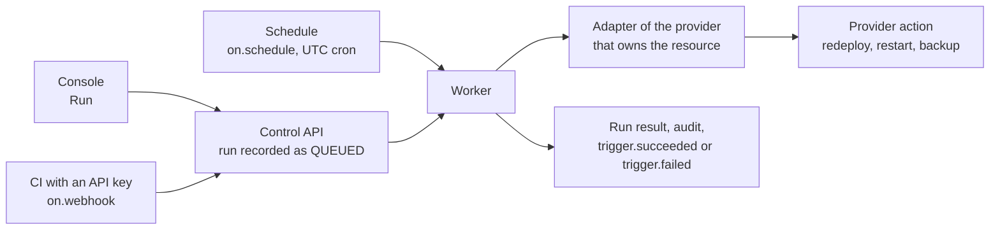

Triggers are declared in the template ([reference](/docs/developer/template-reference/#triggers))
and apply to every instance built from it. Each one runs a single action on a single resource
through the provider that owns it, so the action and its parameters depend on the provider: a
Vercel project offers `redeploy`, `promote`, `rollback` and `purge-cache`; a Render service offers
`redeploy`, `restart`, `rollback`, `scale`, `suspend` and `resume`; a Supabase database offers
`restart`, `pause`, `restore` and `backup`; a Cloud Run or Container Apps service offers `redeploy`
or `restart`.

A trigger starts work at the provider and records the result: the provider deployment or backup
it started, a link when there is one, and a message. It does not wait for a build to finish; the
instance health and the provider deployment history show how that ends.



## Run from the console

Open the instance and choose **Triggers**. Each trigger shows the resource and action, how it can
run (manual, API key, schedule) and its last result. **Run** opens the parameters the template
marks as overridable; everything else keeps its template value. Running a trigger needs the
deploy permission on the instance.

A trigger is unavailable while its resource is not deployed, or when the provider of that
resource does not offer the action (for example a template that asks for `backup` on a provider
without on demand backups). The console shows the reason.

## Run from CI

Triggers with `on.webhook: true` accept calls from an [API key](/docs/developer/api-keys/) with
the `instances:deploy` scope:

```bash
curl -X POST "$ORKSTAGE_API/instances/$INSTANCE_ID/triggers/redeploy-site/runs" \
  -H "Authorization: Bearer $ORKSTAGE_API_KEY" \
  -H "Content-Type: application/json" \
  -d '{"params":{"ref":"main"}}'
```

The call returns `202` with the run (`status: QUEUED`). Parameters that are not overridable,
unknown to the action or of the wrong type are rejected with `422` before anything reaches the
provider. A trigger without `on.webhook` refuses API keys with `403`.

## Schedules

`on.schedule` takes a five field cron expression in UTC. The worker keeps one schedule per
trigger and instance, replaces it after every deployment (so a changed or removed schedule takes
effect with the next deploy) and removes it when the instance is destroyed. Scheduled runs are
skipped while the instance is not `READY` or `DEGRADED`.

## Runs and notifications

Every run is stored with its source (`MANUAL`, `SCHEDULE`, `WEBHOOK`), parameters, status and
result, and appears under **Recent runs** and in `GET /instances/{id}/trigger-runs`. Runs are
audited, and their outcome is sent as the `trigger.succeeded` and `trigger.failed`
[notification and webhook events](/docs/developer/webhooks/).
