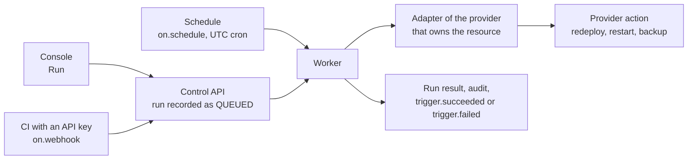

Triggers are declared in the template ([reference](/docs/developer/template-reference/#triggers))
and apply to every instance built from it. Each one runs a single action on a single resource
through the provider that owns it. Name a **catalog action** and the same trigger works on every
provider that has it; a provider's own action name (Vercel's `promote`, Render's `suspend`) runs
only there.

A trigger starts work at the provider and records the result: the provider deployment or backup
it started, a link when there is one, and a message. It does not wait for a build to finish; the
instance health and the provider deployment history show how that ends.



## Catalog actions

The catalog gives every provider the same names, risks and parameters, and it is the only set of
actions OrkStage's planned AI agents may propose (they never run one themselves).

| Action | Resource | Risk | What it does |
|---|---|---|---|
| `service.restart` | service | safe | Fresh instances of the running release; old ones drain as new ones turn healthy. |
| `service.redeploy` | service, frontend | safe | A new rollout from the source. |
| `service.scale` | service | disruptive | Sets `replicas`, within the template autoscaling bounds or up to the tenant's replica limit. |
| `cdn.invalidate` | frontend | safe | Drops cached responses. |
| `database.reboot` | database | disruptive | Reboots the server; connections drop for a short while. |
| `database.snapshot` | database | safe | An on demand backup, kept until deleted. |
| `database.restore` | database | safe | A point in time copy next to the original (`pointInTime`). |
| `release.rollback` | service, frontend | disruptive | Returns to an earlier deployment (`deployment`). |

On AWS, ECS services offer `service.restart` and `service.scale`, and RDS databases offer
`database.reboot`, `database.snapshot` and `database.restore`. Other providers map their own actions
onto the catalog: Render's `scale` with `numInstances` is `service.scale` with `replicas`, and a
Supabase `restart` is `database.reboot`. The trigger list shows the provider and the risk of each
trigger.

**Who may run it.** A `safe` action needs the developer role, anything else (and any provider
specific action) the admin role. A trigger's `role` field can ask for more, never for less. A run
without the role is refused with `403 ACTION_ROLE_REQUIRED`.

## Run from the console

Open the instance and choose **Triggers**. Each trigger shows the resource and action, how it can
run (manual, API key, schedule) and its last result. **Run** opens the parameters the template
marks as overridable; everything else keeps its template value. Running a trigger needs the
deploy permission on the instance.

A trigger is unavailable while its resource is not deployed, or when the provider of that
resource does not offer the action (for example a template that asks for `backup` on a provider
without on demand backups). The console shows the reason.

## Run from CI

Triggers with `on.webhook: true` accept calls from an [API key](/docs/developer/api-keys/) with
the `instances:deploy` scope:

```bash
curl -X POST "$ORKSTAGE_API/instances/$INSTANCE_ID/triggers/redeploy-site/runs" \
  -H "Authorization: Bearer $ORKSTAGE_API_KEY" \
  -H "Content-Type: application/json" \
  -d '{"params":{"ref":"main"}}'
```

The call returns `202` with the run (`status: QUEUED`). Parameters that are not overridable,
unknown to the action or of the wrong type are rejected with `422` before anything reaches the
provider. A trigger without `on.webhook` refuses API keys with `403`.

## Schedules

`on.schedule` takes a five field cron expression in UTC. The worker keeps one schedule per
trigger and instance, replaces it after every deployment (so a changed or removed schedule takes
effect with the next deploy) and removes it when the instance is destroyed. Scheduled runs are
skipped while the instance is not `READY` or `DEGRADED`.

## Restore a database

On AWS, a `database.postgresql` resource offers the `restore` action. It restores the database to
a point in time as a **new** RDS instance next to the original (same subnet group and security
groups), and leaves the original untouched:

```yaml title="template excerpt"
triggers:
  - name: restore-database
    description: Restore the database to a point in time as a new instance.
    resource: database
    action: restore
    on: { manual: true }
```

Run it with an optional `pointInTime` parameter (an ISO time inside the restore window shown on
the database card); without it, the latest restorable time is used. OrkStage does not manage the
copy: check it, point the application at it, and delete it when you no longer need it. The
simulator runs the same action for tests.

## Runs and notifications

Every run is stored with its source (`MANUAL`, `SCHEDULE`, `WEBHOOK`), parameters, status and
result, and appears under **Recent runs** and in `GET /instances/{id}/trigger-runs`. Runs are
audited, and their outcome is sent as the `trigger.succeeded` and `trigger.failed`
[notification and webhook events](/docs/developer/webhooks/).
